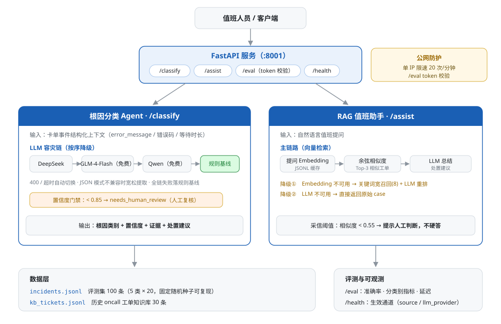
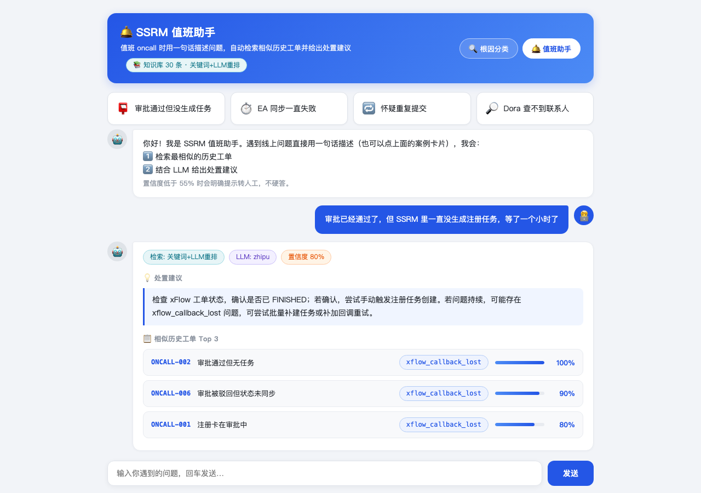
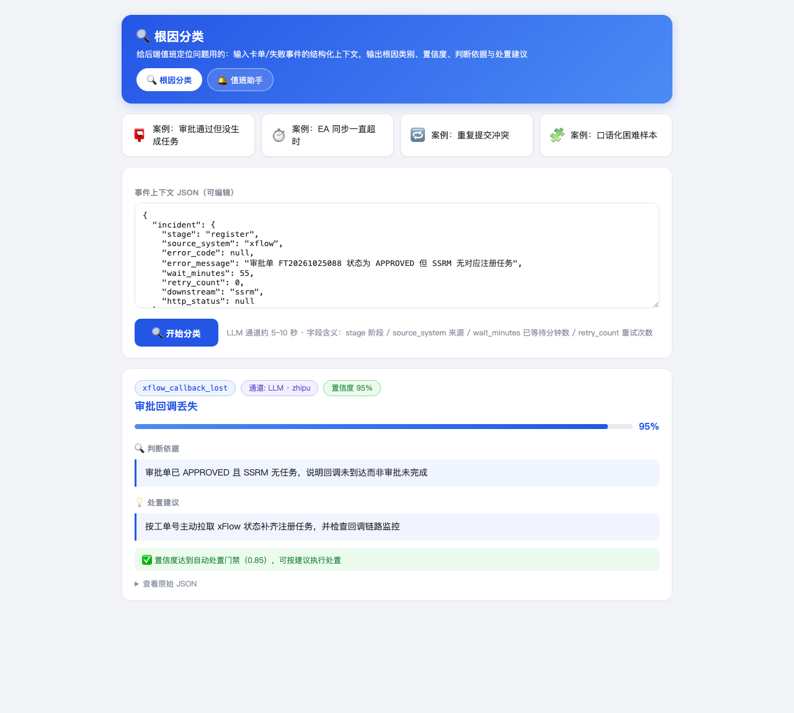

# SSRM Ops Agent — 供应商系统智能运维 Agent

> 源自两年供应商系统（SSRM）oncall 的真实痛点：卡单排查要跨 xFlow / EA / Dora 等 5 个系统翻日志，同步失败靠人工发现。
> 本项目把这类高频场景做成 Agent：**根因自动分类 + 历史工单检索问答**，全链路可评测、可降级、可部署（FastAPI + LLM + RAG）。

## 定位

根因分类 Agent：输入一条卡单/失败事件的结构化上下文，输出**根因类别 + 置信度 + 证据 + 处置建议**。

5 类根因体系（来自真实 oncall 归因）：

| 类别 | 场景 | 标准处置 |
|---|---|---|
| `xflow_callback_lost` | xFlow 审批已通过但回调未达 SSRM | 按工单号主动拉状态补齐 |
| `ea_sync_timeout` | 向 EA 同步超时/5xx | 异步退避重试 + 对账兜底 |
| `duplicate_submit` | 重复提交/幂等冲突 | 幂等去重，无需人工 |
| `data_inconsistency` | 多下游部分成功的数据缺口 | 对账补推 |
| `frontend_param_error` | 前端/参数错误 | 拒绝并反馈字段问题 |

## 架构



## 架构要点

1. **多 LLM Provider 容灾链**：`primary(DeepSeek) → zhipu(glm-4-flash 永久免费) → siliconflow(免费 Qwen) → 规则基线`，逐个尝试自动切换；`/health` 暴露当前链路，响应里的 `source` / `llm_provider` 字段可观测实际生效通道
2. **JSON 模式兼容性处理**：部分模型（如 glm-4-flash）不支持 `response_format=json_object`，遇 400 自动降级为宽松 JSON 提取（剥 markdown 围栏 / 平衡花括号截取）
3. **双通道降级**：全链 LLM 失败才回落规则基线，服务可用性不依赖任何外部 LLM
4. **置信度门禁**：低于 0.85 标记 `needs_human_review` —— 沿用真实 SSRM「审批人工门禁」的设计哲学
5. **评测内建**：`/eval` 端点 + 命令行脚本，准确率/分类别指标/平均延迟/混淆样例
6. **公网防护**：`/classify` `/assist` 单 IP 滑动窗口限速（20 次/分钟）；`/eval` 因单次请求会循环调用 LLM，要求 token 校验（`.env` 配置 `SSRM_AIOPS_EVAL_TOKEN`）

## 页面演示

在线体验（LLM 响应约 5~10 秒）：
- 值班助手：`http://124.222.174.133:8001/assistant`（加 `?demo=1` 自动运行预设问题）
- 根因分类：`http://124.222.174.133:8001/playground`（加 `?demo=1` 自动运行预设案例）

**值班助手**——自然语言提问 → 相似工单检索 + LLM 处置建议（置信度分级、相似度进度条）：



**根因分类**——结构化事件上下文 → 根因类别 + 置信度 + 判断依据 + 处置建议：



## RAG 值班助手

30 条历史 oncall 工单知识库（`data/kb_tickets.jsonl`），值班提问 → 检索相似工单 → LLM 总结处置建议：

- **向量检索优先**：embedding-2 向量化 + 余弦相似度 Top-3（JSONL 持久化缓存，二次启动免重复调用）
- **降级链路**：embedding 不可用（免费档余额限制）→ 关键词宽召回(8) + LLM 重排序取 Top-3；LLM 不可用 → 直接返回原始 case
- **采信阈值**：相似度 < 0.55 提示人工判断，不硬答
- **可视化页面**：`GET /assistant` —— 聊天式问答、预设问题、置信度分级着色、相似工单表格、模式/通道徽标

页面入口：`/playground`（根因分类）· `/assistant`（值班助手）

## 快速开始

```bash
# 1. 环境（复用 aiops venv）
pip install -r requirements.txt

# 2. 配置 LLM（不配置则自动走规则基线）
cp .env.example .env   # 填入 DeepSeek API Key

# 3. 启动
python -m uvicorn app.main:app --port 8001

# 4. 评测
python -m app.eval 30
```

## 数据集

`data/incidents.jsonl`：100 条合成事件（5 类 × 20），字段模拟真实工单上下文。
生成脚本：`scripts/gen_dataset.py`（固定随机种子，可复现）。

> ⚠️ 已知局限：合成数据与规则基线同源（模板生成），规则基线准确率偏乐观（当前 100%）。
> **下一步：构建困难测试集**——改写表述、加入未见过的错误码组合、边界样本，让规则失效、检验 LLM 的泛化能力，那才是真实差距。

## 目录结构

```
ssrm-aiops/
├── app/
│   ├── config.py      # pydantic-settings 配置（SSRM_AIOPS_ 前缀）
│   ├── llm_client.py  # OpenAI 兼容客户端（超时/重试/JSON 模式）
│   ├── classifier.py  # 根因分类 Agent（LLM + 规则基线双通道）
│   ├── dataset.py     # 数据集加载
│   ├── eval.py        # 命令行评测
│   └── main.py        # FastAPI（8001）
├── data/incidents.jsonl
├── docs/               # 架构图 + 页面截图
├── scripts/gen_dataset.py
├── .env.example
└── requirements.txt
```
